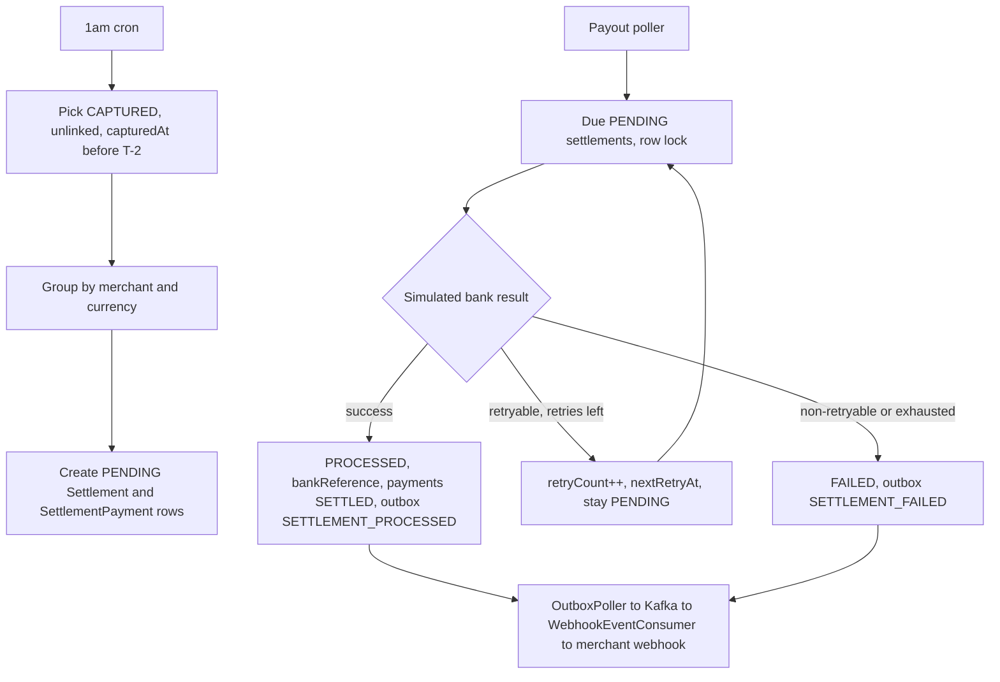

# Settlement engine

## Existing pieces to reuse

- `PaymentStatus.SETTLED`, `PaymentEvent.SETTLE` and the `CAPTURED -> SETTLED` transition already exist in [PaymentStateMachine.java](src/main/java/com/vinayms/razorpayclone/payment/statemachine/PaymentStateMachine.java). No state-machine change is needed.
- `kafka.topics.settlement` is configured in `application.yaml`, and [WebhookEventConsumer.java](src/main/java/com/vinayms/razorpayclone/webhook/WebhookEventConsumer.java) already listens to it.
- `SETTLEMENT_PROCESSED` and `SETTLEMENT_FAILED` are already allowed in `WebhookEventsValidator`.
- `OutboxService.record(...)` requires an active transaction (`Propagation.MANDATORY`), so call it inside the settlement transaction.
- The consumer needs a top-level `merchantId` in the event payload JSON.

## 1. Payment changes

- [Payment.java](src/main/java/com/vinayms/razorpayclone/payment/entity/Payment.java): add `capturedAt` (`LocalDateTime`, column `captured_at`) and an index on `(status, captured_at)`. There is no backfill, and `ddl-auto: update` adds the column.
- [PaymentTransitionService.java](src/main/java/com/vinayms/razorpayclone/payment/service/PaymentTransitionService.java): when the event is `CAPTURE_SUCCESS`, set `capturedAt = now()`. This covers the auto-capture path in `resolveAuthorization`.
- [PaymentRepository.java](src/main/java/com/vinayms/razorpayclone/payment/repository/PaymentRepository.java): add queries for payments that are `CAPTURED`, have `capturedAt < :cutoff`, and have no row in `settlement_payment`. One query returns the distinct `(merchantId, currency)` pairs, and one returns the payments for a merchant.

## 2. Settlement entity and status

- `SettlementStatus`: replace `INITIATED` with `PENDING`, and add `FAILED`. The values become `PENDING, PROCESSED, FAILED, REVOKED`.
- [Settlement.java](src/main/java/com/vinayms/razorpayclone/operations/entity/Settlement.java):
  - Add `@Enumerated(EnumType.STRING)` on `status`.
  - Add `retryCount`, `nextRetryAt`, `failureCode`, `failureReason` and `failedAt`.
  - Add a unique index on `bank_reference`.
  - `refundAmount` is set to 0 for now.
- [SettlementPayment.java](src/main/java/com/vinayms/razorpayclone/operations/entity/SettlementPayment.java): add `@Table(uniqueConstraints = @UniqueConstraint(columnNames = "payment_id"))`, so a payment can never be in two settlements.
- WIP note: the `settlement` table's `status` column currently has no `@Enumerated`, so it is an ordinal column. Drop the `settlement` and `settlement_payment` tables once, because `ddl-auto: update` won't change the column type.
- Repositories `SettlementRepository` and `SettlementPaymentRepository` go in `operations/repository`. `SettlementRepository` has a due-pending query that uses `PESSIMISTIC_WRITE` with `SKIP LOCKED`.

## 3. Settlement creation job

New package `operations/settlement`.

- `SettlementProperties` (`@ConfigurationProperties("settlement")`) holds these values:
  - `hold-days = 2`
  - `fee-percent = 2.0`
  - `gst-percent = 2.5`
  - `zone = Asia/Kolkata`
  - `create-cron = 0 0 1 * * *`
  - `max-retries = 3`
  - the backoff schedule
- `SettlementCalculator` is a pure function using `BigDecimal` with `HALF_UP` rounding:
  - fee = round(gross \* 2%)
  - gst = round(fee \* 2.5%)
  - net = gross - fee - gst - refund
- `SettlementScheduler` runs `@Scheduled(cron=..., zone=...)`.
  - The cutoff is `LocalDate.now(zone).minusDays(holdDays).atStartOfDay()`, so payments with `capturedAt` before that are picked up.
  - It loops over the `(merchantId, currency)` pairs and calls `SettlementService.createForMerchant(...)` for each.
  - It is not transactional itself.
  - It catches and logs per-merchant errors.
- `SettlementService.createForMerchant` is `@Transactional` and runs in a separate bean, so the proxy applies. It:
  - loads the payments,
  - sums the gross in a `long` and uses `Math.toIntExact`, because `Money.amountUnits` is an `int`,
  - runs the calculator,
  - saves a `Settlement` with status `PENDING`,
  - saves the `SettlementPayment` rows.
- The nightly query is "CAPTURED, unlinked, and before the cutoff". That means a missed run catches up on the next night.

## 4. Payout job and simulator

- `SettlementSimulatorConfig` (`settlement.simulator.*`) holds `poll-interval-ms`, `success-rate` and `chaos-mode`, reusing the `ChaosMode` enum.
- `SettlementPayoutSimulator` follows the shape of [BankCallbackSimulator.java](src/main/java/com/vinayms/razorpayclone/payment/simulator/BankCallbackSimulator.java). It polls with `@Scheduled(fixedDelayString=...)` for `PENDING` settlements where `nextRetryAt IS NULL OR nextRetryAt <= now`.
  - It randomizes with `ThreadLocalRandom`, not `hashCode()`, so retries can succeed.
  - It picks either a retryable failure such as `BANK_TIMEOUT` or a non-retryable one such as `INVALID_ACCOUNT`.
  - It treats a merchant with a null `settlementBankAccountNum` as a non-retryable failure.
- `SettlementPayoutService.process(id)` is `@Transactional`, runs in a separate bean, and takes a row lock on the settlement:
  - **Success:**
    - status becomes `PROCESSED`
    - `processedAt` is set
    - `bankReference = "STL" + RandomizerUtil.randomBase64(15)`, which is 23 characters
    - each linked payment is moved through `transitionService.createTransition(payment, SETTLE)`, so it becomes `SETTLED`
    - a `SETTLEMENT_PROCESSED` outbox event is recorded
  - **Retryable failure with retries left:**
    - `retryCount++`
    - `nextRetryAt = now + backoff`
    - status stays `PENDING`
    - no event is sent
  - **Non-retryable failure or retries exhausted:**
    - status becomes `FAILED`
    - `failedAt`, `failureCode` and `failureReason` are set
    - a `SETTLEMENT_FAILED` outbox event is recorded
  - Payments stay `CAPTURED` and linked on any failure.
- There is no admin retry endpoint, as agreed.

## 5. Outbox and webhook events

- `EventAggregateType`: add `SETTLEMENT`. `KafkaTopicProperties.validate()` will resolve it to the existing `kafka.topics.settlement` entry.
- `OutboxEventType`: add `SETTLEMENT_PROCESSED` and `SETTLEMENT_FAILED`.
- New `SettlementEventPayload` record: `settlementId`, `merchantId`, `grossAmount`, `feeAmount`, `gstAmount`, `netAmount`, `status`, `bankReference`, `failureCode`, `failureReason`, `processedAt` and `paymentIds`. It has a top-level `merchantId` for the consumer.
- It follows the same call pattern as `recordPaymentEvent` in `PaymentServiceImpl`: `outboxService.record(EventAggregateType.SETTLEMENT, settlement.getId(), eventType.name(), payload)`.
- The existing `OutboxPoller`, Kafka, `WebhookEventConsumer` and delivery code need no changes.

## 6. Config

Add a `settlement:` block to `application.yaml` for the properties above. Add `settlement.simulator:` for `poll-interval-ms`, `success-rate` and `chaos-mode`.

## Flow

## Assumptions

- Assumption: "T-2" means `capturedAt` is before the start of the day two days ago. The `hold-days` setting makes this easy to change.
- Existing bug, outside this plan: in `PaymentServiceImpl.capturePayment`, the code sets `status = CAPTURED` and then calls `createTransition(CAPTURE_SUCCESS)`. The state machine rejects that, because `CAPTURED` has no `CAPTURE_SUCCESS` transition. The manual capture endpoint likely throws. The `FAILED` branch has the same problem. Only the auto-capture path in `resolveAuthorization` works, and `capturedAt` is set there. Fix the manual capture path if you want to settle manually captured payments.
